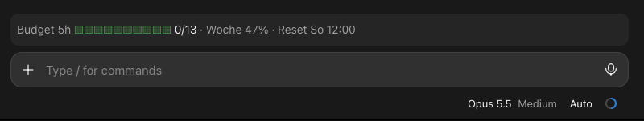

# budget-guard

An agent running wild can eat half your weekly limit in a few hours. budget-guard watches how fast
your account's 7-day limit rises within a sliding window (default: 10 percentage points in 5 hours).
Go over that and it stops **all** running sessions and subagents before the next request goes out.

Why now: since Max 20x became [Ultra](https://support.claude.com/en/articles/17728952-what-is-the-ultra-plan),
verified accounts no longer have a five-hour limit, only the weekly one. Nothing slows a runaway
agent down anymore before the week is gone. budget-guard brings that brake back, on your terms.

A band above the prompt shows usage in the window, the weekly total and the next reset:




Once the lock is on, `/budget-guard-reset` lifts it; the window then counts from that moment.

Click **Stats** in the band (or run `/budget-guard-stats`) to open a pane with usage per day and per
hour of day, so you can see where the budget actually goes.

**Options** (asked on install):

| Option | Default | Meaning |
| --- | --- | --- |
| `maxPercent` | 10 | Max. percentage points of the weekly limit per window |
| `windowHours` | 5 | Length of the sliding window in hours |
| `historyDays` | 7 | How long samples are kept |

Everything stays local: the guard only reads the limit values Claude Code already receives and sends
no requests of its own. It uses no shell and no file paths, so it runs the same on macOS, Linux and
Windows.

## Install

In a Claude Code session in the terminal:

```
/plugin install budget-guard --marketplace xel-x/claude-budget-guard
```

Then `y` to add the marketplace and pick a scope. Or from a shell:

```
claude plugin install budget-guard --marketplace xel-x/claude-budget-guard
```

In the desktop app: **+** next to the prompt → Plugins → Add marketplace `xel-x/claude-budget-guard` → Add plugin.

## Development

```
claude --plugin-dir .        # try it locally
claude plugin test .         # run the tests
```

Release: bump `version` in `.claude-plugin/plugin.json`, then `git tag v0.9.0 && git push --tags`.
The workflow creates the GitHub release.

## License

MIT
